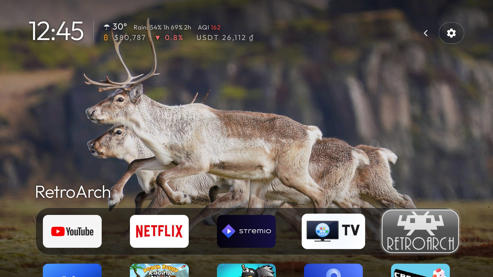
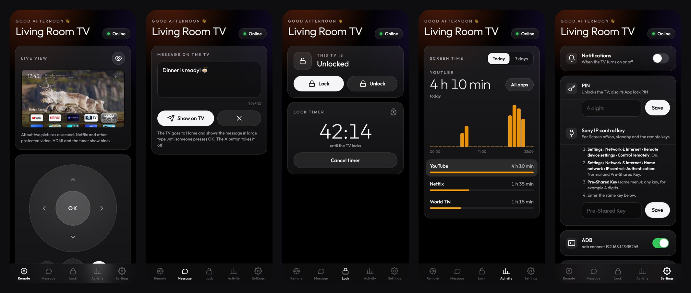

# TV Home + Remote

An Apple TV–style home screen for an Android TV (here a Sony BRAVIA), and a phone remote that reaches it
from anywhere through a small Cloudflare relay. No root, no app store, no account.



Built on [CleanYourTV](https://github.com/Gathin23/cleanyourtv) by [@gathint](https://x.com/gathint), which
debloats the TV and replaces the stock launcher. The debloat guide, the lists for 30 TVs and the tools are
in [docs/cleanyourtv.md](docs/cleanyourtv.md).

## On the TV

**Home**
- A black home with a dock of favourite apps in a rounded band, a top shelf naming the focused app in large
  type and an ambient glow taken from its artwork. One glass highlight springs from tile to tile.
- A greeting with your name ("Good afternoon, Alex 👋"), a thin clock and the date in Outfit. On
  birthdays and the days you set, and at Christmas, New Year and Tết, the greeting says so and a Play card
  plays the song.
- A line that takes turns: weather with rain chances and air quality, Bitcoin with its 24 h change, USDT in
  dong, and the next public holiday in Singapore or Vietnam.
- **Now playing** for background music, with play/pause and skip on the remote.
- **Gallery**: your own photos as the background, and a Gallery screensaver with a slow pan and zoom.
- Inputs, Wi-Fi and Settings as frosted buttons. Hold OK on Wi-Fi for the address, the ADB ports and the
  phone remote's QR code; hold OK on Settings for the switches.

**Family**
- **App lock**: chosen apps open only after a 4-digit PIN, with a grace period.
- **Lock TV** and a **lock timer** from the phone: Home comes to the front with "This TV is locked" until
  someone types the PIN; the timer counts down in a corner over whatever is playing.
- **Screen time**: today or the last 7 days, by hour or by day and by app, on the TV and on the phone.
- **Messages**: a line typed on the phone comes up in large type on the TV.

## TV Remote on the phone



A web app you add to the home screen (iPhone or Android), paired by scanning the QR code on the TV.
It works from anywhere, not only at home:

- **Live control**: a live view of the TV's screen (about two pictures a second; protected video shows
  black), a d-pad with OK, Back, Home, Menu, volume, mute, channel, and a **keyboard** that types or pastes
  into the TV's text field.
- **Message**, **Lock** and **lock timer**, **Screen time** by app.
- **Power**: screen off and on (the TV keeps running), standby, and turn on.
- **Notifications** when the TV turns on or off.
- **Live status**: the controls disappear while the TV is offline (with when it was last seen) and come back
  by themselves.
- **Settings**: the PIN, the TV's IP control key, ADB over Wi-Fi on or off with the address to connect to.

**How it works**

```
phone (web app)  ──HTTPS──▶  Cloudflare Worker + Durable Object  ◀──WebSocket──  launcher on the TV
                  ◀─live status, frames─                          ──commands, answers──▶
```

- The launcher keeps one WebSocket open to the relay ([`relay/`](relay/)). The QR code holds the TV's id and
  a phone key; the relay stores only hashes, and the first connection for an id claims it.
- Commands pass through the relay by name, and the TV offers building blocks (any remote button, any Sony
  IP control method, open an app or a link, the TV's own API), so most new features need only the web app.
- Power and the remote keys use the TV's IP control: on the TV, *Settings › Network & Internet › Remote
  device settings › Control remotely* on, and *Home network › IP control* with a pre-shared key, which you
  enter once in the web app.

Details: [`relay/README.md`](relay/README.md).

## Install

You need a computer on the same Wi-Fi as the TV, JDK 21 and the Android SDK.

1. On the TV: Developer options › **USB debugging** on (or **Wireless debugging**).
2. Debloat if you like: [docs/cleanyourtv.md](docs/cleanyourtv.md#quick-start).
3. Build and install the launcher, which also grants the permissions it needs (overlay for the lock timer,
   screen capture for the live view, usage access for screen time, secure settings for ADB):

   ```bash
   TV_HOST=192.168.1.50 launcher/build-and-install.sh
   ```

4. Deploy your own relay (a free Cloudflare account is enough) and point the launcher at it:

   ```bash
   cd relay && npx wrangler deploy          # prints https://tv-remote.<you>.workers.dev
   ```

   Set `remote_relay` in [`launcher/app/src/main/res/values/config.xml`](launcher/app/src/main/res/values/config.xml)
   to that address and build again. Empty switches the phone remote off.

5. On the TV, hold OK on the Wi-Fi button and scan the QR code with the phone. Add the page to the home
   screen. Settings › Remote QR hides the code (showing it again asks for the PIN).

Configuration (dock, hidden apps, greeting, weather, holidays, themes) is in
[`config.xml`](launcher/app/src/main/res/values/config.xml) or a theme's `config.json`; see
[docs/cleanyourtv.md](docs/cleanyourtv.md#the-launcher).

## Credits

[CleanYourTV](https://github.com/Gathin23/cleanyourtv) by Gathin, MIT. [Outfit](https://fonts.google.com/specimen/Outfit),
SIL Open Font License. Weather and air quality from Open-Meteo, Bitcoin from Coinbase, USDT in dong from
Remitano. MIT, see [LICENSE](LICENSE).
